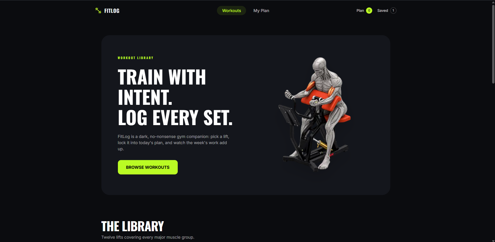
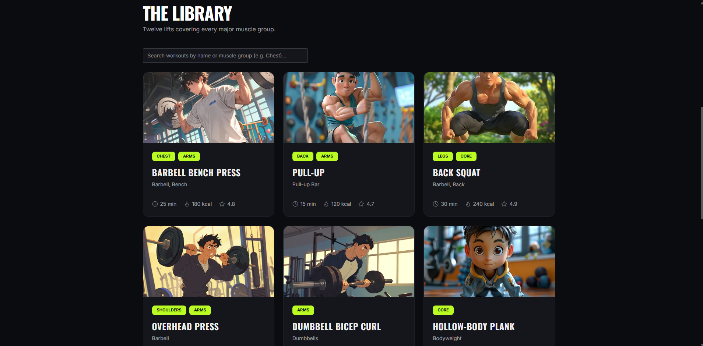
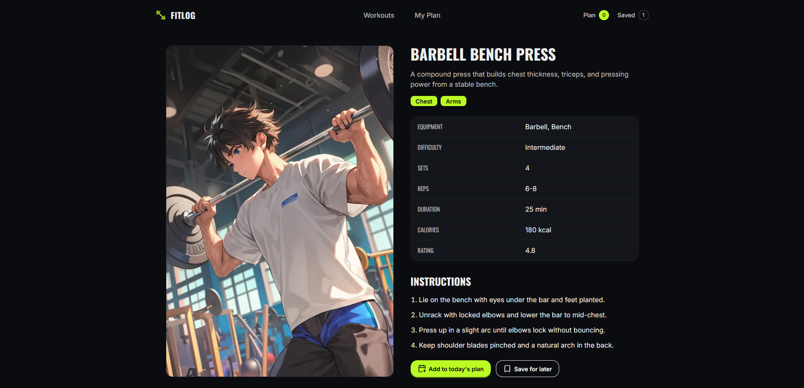
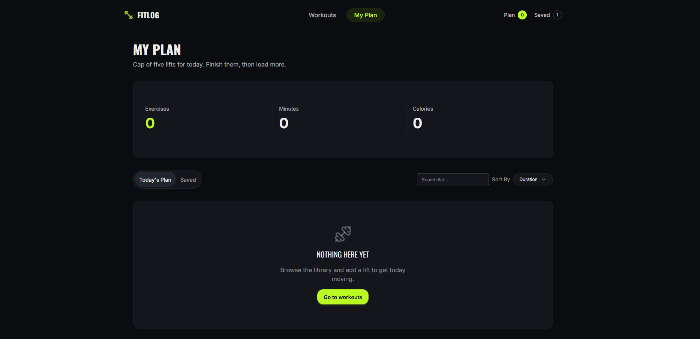
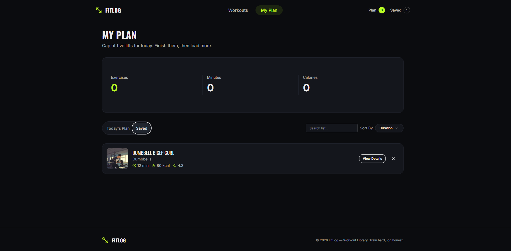

<div align="center">

# 🏋️ FitLog

**A dark, no-nonsense workout library. Pick a lift, lock it into today's plan, and watch the week's work add up.**

[](https://assignment-6-fit-log-weld.vercel.app/)


</div>

---

## 📑 Table of Contents

- [Overview](#-overview)
- [Screenshots](#-screenshots)
- [Key Features](#-key-features)
- [Tech Stack](#-tech-stack)
- [Getting Started](#-getting-started)
- [Author](#-author)

---

## 📖 Overview

**FitLog** is a workout library application that helps lifters plan their sessions without the clutter. Users can browse a curated collection of exercises, review detailed breakdowns and instructions, build a focused daily plan, and keep a saved list of lifts for later. Live session metrics update as the plan grows, and all data persists so progress is never lost when the tab is closed.

🔗 **Live Site:** [https://assignment-6-fit-log-weld.vercel.app](https://assignment-6-fit-log-weld.vercel.app/)

---

## 📸 Screenshots

### Home
A bold landing hero with quick access to the workout library, plus live **Plan** and **Saved** counters in the navbar.



### Workout Library
Twelve lifts covering every major muscle group, with muscle tags, equipment, duration, calories, rating, and instant search.



### Workout Details
Full exercise breakdown including equipment, difficulty, sets, reps, duration, calories, rating, and step-by-step instructions. Add to today's plan or save for later.



### My Plan: Today's Plan
Daily session dashboard with total exercises, minutes, and calories, capped at five lifts per day. Includes search and sorting.



### My Plan: Saved
A separate saved list for lifts to swap into future sessions.



---

## ✨ Key Features

| Feature | Description |
| :--- | :--- |
| **Workout Library** | Browse a curated library of 12 exercises covering every major muscle group, with equipment, difficulty, and step-by-step instructions. |
| **Daily Plan Management** | Build your session with up to 5 exercises in "Today's Plan", or save lifts for later to swap in tomorrow. |
| **Live Session Metrics** | Total exercises, combined workout duration, and total calories burned update in real time as you build your plan. |
| **Smart Search & Sorting** | Search the library by exercise name or muscle group, and sort planned workouts by duration, calories, or rating. |
| **Progress Tracking** | Mark exercises as "Done" as you complete your workout. Plan data saves automatically, so nothing is lost if you close the tab. |

---

## 🛠️ Tech Stack

| Technology | Purpose |
| :--- | :--- |
| **Next.js 16 (App Router)** | Core framework and routing |
| **React 19** | UI library |
| **TypeScript** | Type safety and maintainable code |
| **Tailwind CSS 4** | Utility-first styling |
| **DaisyUI 5** | UI component primitives |
| **Lucide React** | Icon set |
| **React Hot Toast** | Action feedback notifications |

---

## 🚀 Getting Started

### Prerequisites

- [Node.js](https://nodejs.org/) (latest LTS recommended)
- npm

### Installation

```bash
# Clone the repository
git clone <repository-url>
cd <project-folder>

# Install dependencies
npm install

# Start the development server
npm run dev
```

Then open [http://localhost:3000](http://localhost:3000) in your browser.

---

## 👨‍💻 Author

- GitHub: [@Srabon-bot](https://github.com/Srabon-bot)
